# 00 · Index of the AGENT 2027 ablation task documents

*Rogue One v2 design study, ICSE AGENT 2027 (8 pp IEEE), scope T1-minimum, submit **Fri 13 Nov 2026**, one developer (Henrik). Written Thu 8 Oct 2026 from a read of 01 and A01–A23. Every "hoped" result in the documents is a hypothesis, not a finding.*

## 1. Purpose and how to use this index

1. This folder holds one shared document (`01`) and 23 ablation task documents (`A01`–`A23`). This file is the map.
2. **Each A-document is self-contained**: question, background, design, task checklist with due dates, CAIR execution steps, decision rules, risks, definition of done. You can work from one without opening the others.
3. **Shared engineering lives in [01](01_shared_infrastructure.md)**: freeze procedure (§2), E/X tasks (§3), common protocol (§4), CAIR procedure and W&B naming (§5), gates and calendars (§6), and the **canonical registry (§7)** of flags, scripts, metrics, model rungs, dataset IDs, Holm contrasts and gates.
4. If an A-document and 01 disagree on a shared item, **01 wins**; record the difference as a pre-registration amendment.
4a. **Hard rule: covtype is never run, in any study** (Henrik, 2026-10-16: "COVTYPE should never be run!"). This applies to every Rogue One study, not only AGENT 2027: no launcher, dataset list, manifest, session or retry may include it. The launchers in `paper/scripts/` and `scripts/agent2027/` refuse it and exit non-zero. Existing covtype results stay as historical records, but nothing may re-run it.
5. Sources of truth above both: `docs/AGENT2027_T1min_breakdown.md` (budgets, calendar, gates) and `docs/AGENT2027_ablation_directions.md` (master designs). Code is read-only (`nested-cv-rebuttal` @ `07cbf93`). CAIR rules in every execution section: containers only, GPU pre-flight, at most 4 of 8 H100 without explicit approval, W&B as system of record, `ssh CAIR-gpu14` non-interactive with `-T` for `docker compose run`, detached `nohup` with logs in `~`, code by push then `git fetch` over SSH.

## 2. Master table

u = one real-data gpt-oss-120b run (10 iterations x 5 folds). Throughput 2 u/h x 0.7 utilisation = 1.4 u/h on at most 4 H100. Models: O120 = gpt-oss-120b, O20 = gpt-oss-20b, Q0.8/Q2/Q4/Q9/Q122 = Qwen3.5 rungs.

| ID | Doc | Plain question | Claim / Holm contrast | Runs | Budget u | Models | Start → finish | Depends on |
|---|---|---|---|---|---|---|---|---|
| A01 W0 | [A01](A01_W0_old_image_replicate.md) | How much does an identical old-image run move from LLM sampling alone? | None (foundation; gives σ_samp) | 16 | 16–20 (outside window) | O120 (image `nestedcv9`) | Wed 7 Oct → σ̂ table Mon 12 Oct 18:00 | D9; `nestedcv9` image; GitHub push (A01-T4) |
| A02 M4 | [A02](A02_M4_extractor_rounds.md) | Do 3 (or 1) Extractor rounds recover as much as 10, cheaper? | C6; no Holm (cost outside Holm); freezes R | 24 | 12–20 | O120 | Tue 13 Oct → read-out Thu 15 Oct | E1, E2, E3, E5, E8a; M5S (A08 CPU); A01 |
| A03 M1 | [A03](A03_M1_augment_vs_replace.md) | Should the feature pool augment or replace across folds? | Gate (freezes pool mode); outside Holm | 20 (+7 add-on) | 20 (+4.9–7) | O120 | Wed 14 Oct → read-out Thu 15 Oct | E6 (G-E6); A01 σ_samp; A02 (add-on); D6 |
| A04 CAP-0 | [A04](A04_CAP0_stage0_smoke_tests.md) | Can each small model rung run the loop at all (Stage 0)? | None (validity for C5a/C5b) | 8 fold-runs + 350 calls | 7–13 | Q0.8, Q2, Q4, Q9, Q122, O20 (O120 in C) | Downloads 8–11 Oct; A/B Thu 15 Oct; C Wed 21 Oct | E1–E3; X1, X2; E4, E5, E7 (session C) |
| A05 M0 | [A05](A05_M0_full_v2_reference.md) | How good is frozen Full-v2, and how much do identical runs move (A/A)? | None; control for C1a, C1b, C3, C5b; data for C4b | 55 | 47.5–55 | O120 | Fri 16 Oct 18:00 → GPU done Sun 18 Oct; G2 Mon 19 Oct | G1 freeze; E1–E6, E8a, E13, X1, X3, X10; A02, A03, A08 CPU, A01 |
| A06 M0-S | [A06](A06_M0S_session_sentinel.md) | Did the model server drift between sessions? | None (guard 3 for v2.1–v2.4) | 9–17 | 5.7–17 | O120, Q4 | Sun 18 Oct (Q4) / Tue 20 Oct (O120) → Sat 31 Oct | A05; A08 CPU; A04 A; E11b; A17 hosts Q4 |
| A07 HC1 | [A07](A07_HC1_tool_error_feedback.md) | Does hiding tool-error text change results? | C6; outside Holm | 12 | 12–15 | O120 | Fri 16 Oct 18:00 → Sun 18 Oct | G1; A05 (same session); E2, E3, E4, E5 |
| A08 M5 | [A08](A08_M5_bruteforce_screen_and_comparators.md) | Can brute force (OpenFE, AutoFeat) solve SYN-P; how do LLM-FE and CAAFE compare? | Gate `M5S`; **C1b** LLM-FE − Full | 22 GPU + 81 CPU cells | 9.9–15.4 | none (CPU) / O120 | CPU Mon 12 Oct → read Tue 13; GPU Tue 20 – Sat 24 Oct | E8a, X3, E1; G2, A05, A06, X4, X5, X6 for GPU part |
| A09 RT3 | [A09](A09_RT3_planner_oracle_misdirected.md) | Does the planner channel matter (oracle vs misdirected)? | Planner half of G3; sets TOST margin δ; outside Holm | 15 | 10.5–15 | O120 (S makes no calls) | Mon 19 Oct → δ Fri 23 Oct → G3 Mon 26 Oct | E9c, E8a; A05, A08 CPU, E11b (GLMM part); G2 |
| A10 LF1 | [A10](A10_LF1_restarts_vs_refinement.md) | Is building on earlier rounds better than independent restarts? | **C3** Restarts − Full | 14 | 9.8–14 | O120 | Tue 20 Oct → ≈ Wed 21 Oct | E9a; A05, A06, A08, A09 (G3), A03; shares session with A11 |
| A11 LF2-L0 | [A11](A11_LF2L0_open_loop_planner.md) | Does the loop use feedback at all (open-loop planner)? | Exploratory C3; outside Holm; CL7/ED6 | 14 | 9.8–14 | O120 | Tue 20 Oct → ≈ Wed 21 Oct | E9b; A05, A06, A08, A09, A10 |
| A12 FX | [A12](A12_FX_component_half_fraction.md) | Which roles (A, J, P) need an LLM? | **C2a, C2b** (TOST), **C2c** | 56 | 39.2–56 | O120 | Wed 21 Oct evening → Sun 25 Oct; G4 Tue 27 | E9c, E9d; A09-T15 (δ); A05, A06, A08; A13, A14, A16 share sessions |
| A13 KT1-Off | [A13](A13_KT1_search_off.md) | What does web search cost and buy? (search off) | C4 cost side; outside Holm | 10 (+10 RV2) | 9–11 | O120 | Wed 21 Oct evening → Fri 23 Oct; RV2 Mon 26 | E9e; A05, A06, A12 (session) |
| A14 KT3-P7 | [A14](A14_KT3_knowledge_probe_P7.md) | Does correct local knowledge beat no knowledge on P7? | **C4a** Local-correct − Off; knowledge half of G3 | 18 | 12.6–18 | O120 | Wed 21 Oct night → Fri 23 Oct; G3 Mon 26; kill G4 | E8b, E9e, X9; A02 (P7 queries), A05, A08, A09, A13 |
| A15 KT2-min | [A15](A15_KT2min_named_vs_anonymised.md) | Does knowledge help only when feature names carry meaning? | **C4b** P6b − P6a (McNemar) | 0 (+2 opt. AB2) | 0 (+1.4–2) | O120 (A05 data) | Data Fri 16 – Sun 18 Oct → final Tue 3 Nov | D8; E8a; A05; A08 CPU |
| A16 RT2 | [A16](A16_RT2_set_phased.md) | Is decomposition better than simply more compute (SET-phased)? | **C1a** SET-phased − Full | 26 | 21.8–26 | O120 | Pilot Thu 22 Oct → K-SET Fri 23 → Core-10 Mon 26 – Thu 29 | E9f; A05, A08, A06, A09-T15 (δ), A12 |
| A17 CAP-1 | [A17](A17_CAP1_scale_ladder.md) | How small a model can run the loop (capability floor)? | **C5a** `func_success` trend (Qwen rungs) | 87 + 77 F0 pool jobs (49,280 one-shot) | 53.0–97.1 | Q0.8–Q122, O20, O120 (F0) | Sun 18 Oct night → last launch Thu 29 | A04, A05, A06, A08; X7, E7, E11d; A18, A20 |
| A18 RP1 | [A18](A18_RP1_rolewise_replay.md) | Which role fails first at small scale (replay O120 prompts)? | Exploratory; outside Holm | 5,600 replays | 3.6–7.0 (card 4–7) | Q0.8–Q122, O20, O120 | Prep Tue 13 → slots Thu 22 – Tue 27 Oct | A05 traces; A04; X2; E3, E4; A17, A20 slots |
| A19 CAP-2 | [A19](A19_CAP2_role_mixing.md) | Can roles use different models (small Extractor, 1B cell)? | **C5b** E-small − all-big; 1B cell outside Holm | 36 | 27.6–54 | O120, O20, Q0.8 | Earliest Thu 22 Oct → latest launch Tue 27 | E7; A04 (SR4, SR6); A05, A06, A08, A09-T15; A17, A20 |
| A20 CAP-3 | [A20](A20_CAP3_harness_at_O20.md) | Does the minimal harness still work on a 20B backbone? | Exploratory; outside Holm | 7 | 3.5–7 | O20 (O120 comparison) | Smoke Thu 22 Oct → latest launch Thu 29 | E9d, E7; A04 (O20 pass); A05, A12, A17 |
| A21 M2 | [A21](A21_M2_anytime_curve.md) | Do arms stay equal at equal cost (anytime curves, iso-cost)? | None; descriptive (C1 iso-cost view) | 0 (CPU) | 0 | none | Prelim Mon 19 Oct → final Sun 1 – Tue 3 Nov | E3, E11b, X5, X10; A05; all arm data |
| A22 M3 | [A22](A22_M3_evaluator_transfer.md) | Do selected features help other evaluators (XGBoost, linear, RF)? | None; validity; ED5 | 0 (CPU; 20 OpenFE cells) | 0 | none (A05 features) | Prereqs Mon 12 Oct → final Mon 2 – Tue 3 Nov | E3, E6, X3; A05, A08; E11a, E11b |
| A23 CAP-6 | [A23](A23_CAP6_cost_pareto.md) | What is the cost Pareto front across all arms and rungs? | None; descriptive (C1, C5 cost) | 0 (CPU) | 0 | none | Draft Tue 27 Oct → final Sun 1 – Tue 3 Nov | E3, E4, E11b, X5, X7, E11d; A09-T15; data from A02–A20 |

**Totals and capacity** (01 §4.9, R1):

| Item | Value |
|---|---|
| In-window demand (A02–A20, excluding A01 and the A03 add-on) | ≈ 425–433 full runs, **314.9–474.5u** |
| Outside the window / optional | A01 16–20u; A03 add-on +4.9–7u; AB1–AB5; RV1–RV3 from reserve |
| With 15% rerun reserve | 362–546u |
| Gross window capacity (Tue 13 – Sat 31 Oct, 0.7 util) | 638u |
| Post-freeze capacity (Fri 16 18:00 → Sat 31) | **≈ 512u**; usable **≈ 550–570u** |
| Post-freeze demand | 278–426u (319–490u with reserve): fits at every point |
| Binding constraint | **Developer time**, not GPU (see §6, items 3–4) |

## 3. Dependency graph

```mermaid
flowchart LR
  subgraph SH["Shared tasks (01)"]
    E1["E1 flags + launcher"]
    E2["E2 v2 fixes + R knob"]
    E3["E3 instrumentation"]
    E5["E5 prompt dump"]
    E6["E6 augment mode"]
    E8a["E8a SYN-P + detector"]
    E9["E9a-f switches"]
    E7["E7 ladder launcher"]
    E11["E11a/b analysis"]
    X10["X10 pre-registration"]
  end
  E1 & E2 & E3 & E5 & E8a --> G0a{{"G0a Mon 12"}}
  G0a --> A08c["A08 CPU screen"]
  A08c --> M5S{{"M5S Tue 13"}}
  M5S --> A02
  G0a --> A02
  A01 --> A02
  A01 --> A03
  E6 --> A03
  A02 --> G1
  A03 --> G1
  X10 --> G1
  A04 --> A17 & A18 & A19 & A20 & A06
  G1{{"G1 freeze Fri 16"}} --> A05
  G1 --> A07
  A05 --> G2{{"G2 Mon 19"}}
  E11 --> G2
  A05 --> A06
  A05 --> A15
  G2 --> A09 & A10 & A11 & A12 & A13 & A14 & A16 & A17 & A19 & A20 & A08g["A08 GPU"]
  E9 --> A09 & A10 & A11 & A12 & A13 & A14 & A16
  E7 --> A17 & A19 & A20
  A09 --> D15["delta (A09-T15, Fri 23)"]
  D15 --> A12 & A16 & A17 & A19
  A09 & A14 --> G3{{"G3 Mon 26"}}
  A12 & A14 --> G4{{"G4 Tue 27"}}
  A17 --> G6{{"G6 Fri 30"}}
  A17 --> A18 & A19 & A20
  G3 & G4 & G6 --> DF{{"DF Sat 31 Oct 24:00"}}
  A06 -. "guard 3" .-> DF
  DF --> A21 & A22 & A23
  A12 & A15 & A14 --> F1["Fig. 1 + title (G3)"]
  A10 & A11 & A13 & A16 & A08g & A21 & A22 & A23 --> F2["Fig. 2 + Table 2"]
  A17 & A18 & A19 & A20 --> F3["Fig. 3 capability"]
```

## 4. Week-by-week calendar, Tue 6 Oct → Fri 13 Nov

| Week | Engineering (01 §6.2) | GPU / CPU sessions | Gates and decisions | Writing |
|---|---|---|---|---|
| **Tue 6 – Sun 11 Oct** | E2 (+R knob); E1a–c; E3; E5; E8a generator, detector, P7 corpus text; E13 | A01 `S1007a` (Wed 7), `S1008a` (Thu 8), reruns to Sun 11; A04 downloads (~203 GB) | D9 Wed 7; **D1 Thu 8** | none |
| **Mon 12 – Sun 18 Oct** | G0a smoke; X3 (Mon 18:00); E6 (Tue); X1, X2; E4; X9; E8b corpus; X10; build v2.0 (Fri); E11a, E9c tooling (Sat–Sun) | A08 CPU screen (Mon night); A02 `S1013a` (Tue); A03 `S1014e`/`S1014b` (Wed); A04 A/B `S1015a`–`f` (Thu); A05 + A07 `S1016a` (Fri 18:00); A17 small rungs from Sun night | G0a Mon 12; M5S + G-E6 Tue 13; D6, D8 Mon 12; D2, D3, D4, D7 Thu 15; **G1 Fri 16**; D5 Fri 16 | Fri 16: pre-registration doubles as protocol draft |
| **Mon 19 – Sun 25 Oct** | E9c hook → v2.1 (Mon); E9a, E9b → v2.2 (Tue); E7, E9d, E9e, E8b backend → v2.3 (Wed); E9f → v2.4 (Thu); X4, X5; X7 (Fri); X6, E11b (Sat–Sun) | A09 `S1019a` (Mon); A10 + A11 `S1020a` (Tue); A08 GPU (Tue–Sat); A12 + A13 + A14 `S1021a` (Wed 20:00 →); A04 C `S1021m`; A19, A20, A18, A16 pilot from Thu 22 (box order open, §6); A16 SYN-P `S1023a` (Fri); A17 Q122 from Sat 24 | **G2 Mon 19**; G0b-1 Wed 21; K-SET Fri 23; δ Fri 23 18:00 | none |
| **Mon 26 Oct – Sun 1 Nov** | E11b done (Tue 27) | A16 Core-10 (Mon 26 – Thu 29); A18 O120 `S1027p`; A17 O120 pools; RV1/RV2/RV3 if triggered; reruns Fri 30 – Sat 31 | **G3 Mon 26**; **G4 Tue 27**; KT3 latest start Wed 28; **L-LAST Thu 29**; G6 Fri 30; **DF Sat 31 24:00** | Mon 26: Fig. 1 and title; Sun 1: final statistics start |
| **Mon 2 – Sun 8 Nov** | E11c, E11d scoring; A22 final | CPU only (A17 F0 scoring, A22, A21, A23) | none | Sun 1 – Tue 3: final statistics, Table 2; **Wed 4 – Fri 6: AGENT full draft**; Sat 7 – Sun 8: short paper |
| **Mon 9 – Fri 13 Nov** | X8 webhook key removal; replication package | none | none | Mon 9 short paper; Tue 10 – Wed 11 co-author review; Thu 12 revisions + package; **Fri 13 submit both** |

## 5. Pre-declared cut order and add-backs

Order is fixed in 01 §4.9. Apply at G1 from measured u, then at G3/G4 and L-LAST.

| Step | Cut | Saving |
|---|---|---|
| CL1 | CAP-2 (A19) on SYN-P only | −8 runs, 8–12u |
| CL2 | CAP-1 (A17) small-rung real data on junglechess and myocardial | −10 runs, 5–10u |
| CL3 | HC1 (A07) on the 4 high-error datasets | −4 runs, 4–5u |
| CL4 | Drop CAAFE (A08), keep LLM-FE | −8 runs, 3.6–5.6u |
| CL5 | Sentinel in every second O120 session, floor 6 (A06) | 3–5u |
| CL6 | Drop F0 pools at Q122/O120 (A17) | 3.5–7u |
| CL7 | Move LF2-L0 (A11) to T2 | −14 runs, 9.8–14u |

- **Re-tier trigger at G1:** apply CL1–CL4 at once if the `R10` arm's mean u per SYN-P run exceeds 0.85u, or R=3 is not adopted.
- **Engineering drops:** ED1 E13 → ED2 X2 (A18 shrinks) → ED3 X7/F0 (drop if not running by Wed 28) → ED4 SET (A16, C1a; K-SET Fri 23) → ED5 M3 (A22) → ED6 L0 (A11).
- **Never cut:** A05 core runs and SYN-P A/A; A03 on Core-10; the A08 CPU screen; A02 R=3 vs R=10; A10 and A09; A14 Off and Local-correct; the 2-seed rungs Q0.8, Q4, Q122.
- **Drop rules for Holm contrasts:** C4b if P6 fails the screen before pre-registration; C1a at K-SET; C4a if KT3 is killed at G4.
- **Add-backs if G1 measures u at the low end, in order:** AB1 A03 SYN-P add-on · AB2 P6 seed-5 pair (+1.4–2u) · AB3 RT3 misdirected on junglechess (+1u) · AB4 Q2 at 2 seeds (+3.7–7.5u) · AB5 VP1 paraphrased prompts (+4.9–7u; set frozen by Oct 16).
- **Reserve-paid only if triggered:** RV1 CAP-5 fallbacks-off (10–16u, checked at G4) · RV2 KT1-Off seed 4 (10u, about Oct 26) · RV3 FX semi-foldover (28 runs, 19.6–28u, at G4).

## 6. Open decisions

Recorded in 01 §6.4 unless noted. "Default" is adopted if Henrik does not object.

| # | Decision | Due | Default / note |
|---|---|---|---|
| D9 | W0 W&B entity (`brainflux` or `PlanBench`); confirm `rogue_one:nestedcv9` exists on CAIR | Wed 7 Oct (overdue) | `brainflux`; image existence still unverified |
| D1 | Work weekends Oct 10–11, 17–18, 24–25, or pre-approve engineering drop order | Thu 8 Oct | none |
| 4 | A01 developer time: ≈ 6.5–7.5 h against ≈ 2 h booked; accept, or drop optional reruns (A01-T15) | Thu 8 Oct, with D1 | none |
| 3 | Developer time outside R2: A18 code ≈ 0.6 d, A22 ≈ 0.65 d before Nov 1, A23 energy ≈ 0.25 d, X7 and E11d probably under-booked; absorb or cut (ED2, ED3, ED5) | Thu 8 Oct, with D1 | none |
| 5 | A01-T4 requires pushing `nested-cv-rebuttal` to GitHub (remote is at `2cd6d0a`) | Thu 8 Oct | push |
| D6 | A03 SYN-P add-on (AB1); accept E6 fallback | Mon 12 Oct | run add-on on idle pre-freeze GPU |
| D8 | KT2-min P6b exact-twin spec | Mon 12 Oct | option A, hidden rescaling |
| 1 | Re-tier trigger: test `R10` arm's mean u or the adopted arm's u | Tue 13 Oct, 10:00 (before A02-T3) | `R10` (canonical) |
| 6 | Satterthwaite-df rule (replaces F(16,16)) in A01 statistics; confirm before X10 | before Fri 16 Oct | adopt |
| D2 | Scientist feedback signal (freeze item 12) | Thu 15 Oct | keep in-sample fit, written justification |
| D3 | C3 definition (pooled vs multi-step subset; P2 placement) | Thu 15 Oct | none |
| D4 | C1b setup: LLM-FE notebook primary, stratified SYN-P C folds, LLM-FE specs | Thu 15 Oct | yes to all |
| D7 | Expose `Status` in `list_known_attributes_tool` (freeze item 14) | Thu 15 Oct | expose |
| Defaults | P7 policy; FX as I = −PAJM; KT2-min; KT3 at 6 seeds; CAP-3 at O20; sentinel rule; corrected M1/M4 rules; W0 on 8 datasets; G3 title rule | Thu 15 Oct | adopted unless objection |
| A14 | Summariser prompt cannot be byte-identical across parametric and local; confirm A14-T8 restatement | Thu 15 Oct | confirm |
| D5 | O120 topology: TP2 or TP4 | Fri 16 Oct, before M0 | measure TP2 throughput in W1 |
| A05 OQ1 | Freeze `DO_BALANCING=True` though t17/W0 used `False`; confirm junglechess threshold 0.95 on balanced accuracy | X10, Fri 16 Oct | accept; do not pool classification σ |
| A15 | Clinical template text not on E5 neutralisation list (changes Full-v2) | before G1, Fri 16 Oct | decide at E5/G1 |
| 2 | **Box order Thu 22 – Wed 28 Oct** (A12, A13, A16, A17, A18, A19, A20): claims cannot all be honoured | G2, Mon 19 Oct | A16 §7 proposal: A20 smoke → A16 pilot → rest |
| A06 Q1–Q3 | O120 sentinel on `S1019a`; Q4 sentinel on O20 session; fallback task if no informative SYN-P | G2, Mon 19 Oct | yes; no; keep rule |
| 7 | Sequence A04 session C `S1021m` against A12 smoke `S1021b` and `S1021a` launch | before Wed 21 Oct | fallback: first gap after `S1021a` |
| 8 | **Unverified, flagged in docs:** `<ROGUEONE_CAIR_PATH>` and GitHub SSH access; whether `nestedcv9` exists; E8a detector and evaluator-API interfaces; whether `make_manifest.py` supports A22 and the no-sentinel option name; A16 §7 slot duration (6–15 h); Qwen3.5 IDs until A04 passes | G0a and A04 checks, from Mon 12 Oct | verify read-only first |
| 9 | A18 budget 3.6–7.0u lies inside the card's 4–7u; totals unchanged (not in 01 §6.4) | none | no action |

## 7. Progress checklist

- [ ] [A01 W0](A01_W0_old_image_replicate.md): old-image replicate, 16 runs, σ̂ table due Mon 12 Oct 18:00
- [ ] [A02 M4](A02_M4_extractor_rounds.md): Extractor rounds R in {1, 3, 10}, 24 runs, freeze R at G1
- [ ] [A03 M1](A03_M1_augment_vs_replace.md): augment vs replace, 20 runs (+7), freeze pool mode at G1
- [ ] [A04 CAP-0](A04_CAP0_stage0_smoke_tests.md): Stage-0 smoke tests and downloads, sessions A/B Thu 15, C Wed 21
- [ ] [A05 M0](A05_M0_full_v2_reference.md): Full-v2 reference + A/A, 55 runs, launch Fri 16 Oct 18:00
- [ ] [A06 M0-S](A06_M0S_session_sentinel.md): session sentinel, 9–17 runs, Sun 18 – Sat 31 Oct
- [ ] [A07 HC1](A07_HC1_tool_error_feedback.md): tool-error text hidden, 12 runs, with A05
- [ ] [A08 M5](A08_M5_bruteforce_screen_and_comparators.md): CPU screen Mon 12 Oct; LLM-FE/CAAFE GPU Tue 20 – Sat 24
- [ ] [A09 RT3](A09_RT3_planner_oracle_misdirected.md): oracle and misdirected planner, 15 runs, δ Fri 23, G3 Mon 26
- [ ] [A10 LF1](A10_LF1_restarts_vs_refinement.md): restarts vs refinement (C3), 14 runs, Tue 20 Oct
- [ ] [A11 LF2-L0](A11_LF2L0_open_loop_planner.md): open-loop planner, 14 runs, Tue 20 Oct (CL7)
- [ ] [A12 FX](A12_FX_component_half_fraction.md): half-fraction A/J/P (C2a–c), 56 runs, Wed 21 Oct evening
- [ ] [A13 KT1-Off](A13_KT1_search_off.md): search off, 10 runs, Wed 21 Oct evening
- [ ] [A14 KT3-P7](A14_KT3_knowledge_probe_P7.md): knowledge probe P7 (C4a), 18 runs, Wed 21 Oct night
- [ ] [A15 KT2-min](A15_KT2min_named_vs_anonymised.md): named vs anonymised (C4b), 0 new runs, data from A05
- [ ] [A16 RT2](A16_RT2_set_phased.md): SET-phased (C1a), 26 runs, K-SET Fri 23 Oct
- [ ] [A17 CAP-1](A17_CAP1_scale_ladder.md): scale ladder (C5a), 87 runs + F0 pools, Sun 18 – Thu 29 Oct
- [ ] [A18 RP1](A18_RP1_rolewise_replay.md): role-wise replay, 5,600 replays, Thu 22 – Tue 27 Oct
- [ ] [A19 CAP-2](A19_CAP2_role_mixing.md): role mixing (C5b), 36 runs, Thu 22 – Tue 27 Oct
- [ ] [A20 CAP-3](A20_CAP3_harness_at_O20.md): harness at O20, 7 runs, Thu 22 Oct
- [ ] [A21 M2](A21_M2_anytime_curve.md): anytime curve and iso-cost, CPU, preliminary Mon 19, final Nov 1–3
- [ ] [A22 M3](A22_M3_evaluator_transfer.md): evaluator transfer, CPU, final Nov 2–3 (ED5)
- [ ] [A23 CAP-6](A23_CAP6_cost_pareto.md): cost Pareto, CPU, draft Tue 27 Oct, final Nov 1–3
